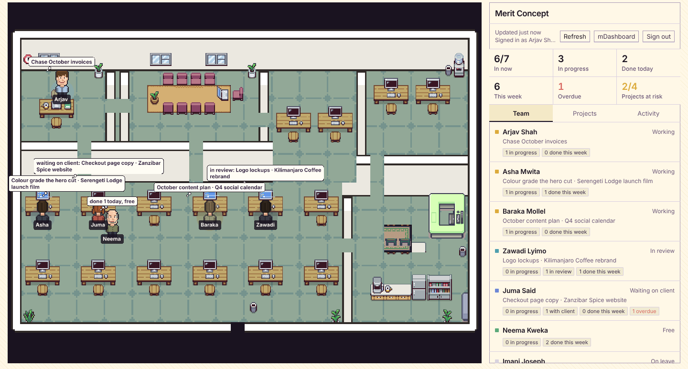

# mOffice: the studio floor

mOffice puts Merit Concept's real team on the Munder Difflin office floor. Flip the
title-bar switch from **Agents** to **Studio** and the office fills with the people in
mDashboard, each at their own desk, showing what they are on right now. The side panel
is the board: who is in, what each person finished this week, and how every live project
is moving. Everything links back to the page in mDashboard where the work lives.

It is **read only**. Nothing on the studio floor changes anything in mDashboard, and the
agents keep running underneath while you look at the team.



## What you see

### On the floor

Every person on the team (admin, manager or team role in mDashboard, not removed) gets a
desk. Desks are handed out in a stable order, so nobody moves when their status changes.
The corner office goes to the first admin.

| State | Comes from | On the floor |
|---|---|---|
| Working | In mDashboard now, with a task in progress | Seated and typing, monitor on, cloud names the task and project |
| In review | In mDashboard now, their latest task is in review | Seated, monitor on, cloud says "in review" |
| Waiting on client | In mDashboard now, their latest task is awaiting the client | Seated, monitor off, cloud says what is with the client |
| Free | In mDashboard now, nothing in hand | Up and about, cloud says what they finished today |
| Away | Not in mDashboard in the last three minutes | Faded at their own desk, no cloud |
| On leave | Approved leave covers today | No desk; listed in the panel |

"What they are on" is the task they most recently touched that is in progress, then one in
review, then one waiting on a client. Somebody who finishes a task between two reads
cheers at their desk. Click anybody to open their card.

### In the panel

- **Totals:** in now, tasks in progress, done today, done this week, overdue, projects at risk.
- **Team:** everybody, working first, with what they are on and their counts.
- **Person card:** what they are on, their queue (to do, in progress, in review, with
  client), what they finished this week, and how long mDashboard has been open today.
- **Projects:** every live project (planning, in progress, review), ending soonest first,
  with a progress bar, tasks done out of total, overdue tasks, the next milestone and who
  is on it. Health is **Overdue** past the end date, **At risk** with overdue tasks or
  ending within a week under 70% done, otherwise **On track**.
- **Activity:** tasks finished this week and the studio's activity log, newest first.

Two figures are named for what they measure, on purpose. *Time with mDashboard open* is
presence, not time worked: somebody editing a film all day is barely in the dashboard.
Counts are shown as their parts and never rolled into a score, so the floor is a status
board, not a ranking.

## How it links to mDashboard

```
mOffice (Electron main)                          mDashboard (Base44)
─────────────────────────                        ──────────────────────────────
Sign in ─▶ opens browser ───────────────────────▶ /functions/suiteSignIn?app=office
            127.0.0.1:<port>/signed-in ◀── form post { state, token } (on button press)
            checks state, GET /entities/User/me
            keeps token encrypted (safeStorage)
Every minute ─▶ POST /functions/officeFloor ────▶ admin only, read under service role,
                                                   cut back in shared/officeFloor.js
            ◀── { totals, people, projects, feed }
Renderer ◀── snapshot only, never the token
```

- **Sign-in** reuses the hand-over mSuite for Mac already uses, so there is no new login
  and no API key to manage. The page only ever posts to `127.0.0.1` on the port mOffice
  chose, with a one-time state mOffice compares exactly.
- **The token** stays in the main process, encrypted at rest with the OS keychain
  (Electron `safeStorage`, through `src/main/integrations.ts`). If the OS cannot encrypt,
  it is not stored.
- **The snapshot** carries names, roles, presence, task titles and dates, project titles
  and progress. It never carries emails, task descriptions, budgets, briefs, internal
  notes, or why somebody is on leave.
- **Who can open it:** admins only, the same rule as mDashboard's activity report. The
  floor shows every colleague's queue side by side. Widening it is one line,
  `OFFICE_ROLES` in mDashboard's `base44/shared/officeFloor.js`.
- **Links** open in the browser and are paths inside mDashboard only (`/tasks/…`,
  `/projects/…`); a full URL in a snapshot is refused.
- **Refresh** is once a minute while the studio floor is on screen, on window focus, and
  on the Refresh button. mDashboard's presence stamps land once a minute, so faster would
  only spend backend credits.

A different mDashboard (a staging copy) can be set under *Use a different mDashboard* on
the sign-in card. Changing it signs you out, since a token only works where it was issued.

## Where the code is

| Repo | File | What |
|---|---|---|
| munder-difflin | `src/shared/mdashboard.ts` | The contract: snapshot types, URLs, sign-in form checks, response handling. Pure, tested in `test/mdashboard.test.cjs`. |
| munder-difflin | `src/main/mdashboard.ts` | Loopback sign-in, encrypted token, calls to mDashboard, IPC. |
| munder-difflin | `src/renderer/src/studio/` | `studioStore.ts` (state, kept apart from the agent store), `StudioFloor.tsx` (the Pixi scene), `StudioPanel.tsx` (the board). |
| munder-difflin | `src/renderer/src/App.tsx` | The Agents / Studio switch. |
| timeless-vision-dashboard | `base44/shared/officeFloor.js` | Builds the snapshot from Users, Tasks, Projects, Milestones, PresenceDay, approved leave and Activity. Pure, tested in `src/lib/officeFloor.test.js`. |
| timeless-vision-dashboard | `base44/functions/officeFloor/entry.ts` | The endpoint. |
| timeless-vision-dashboard | `base44/functions/suiteSignIn/entry.ts` | `app=office` makes the sign-in page say mOffice. |

The studio floor is a separate scene from the agent floor, built from the same parts
(map, camera, cast, desk monitors). The people on it are not agents: they have no
terminal, mailbox or roster entry, and nothing that routes, saves or restarts agents can
see them.

## Not yet

- **mOffice in the mSuite menu.** `src/components/suite/Suite.jsx` is copied identically
  across the suite apps, so adding an mOffice tile is one edit made in all of them, with
  an icon from the mSuite icon pack.
- **Photos.** The renderer's content policy allows no remote images, and opening it would
  let any agent's markdown load a tracking pixel too, so a person card shows an initial.
  Photos could be fetched in main and passed as data URLs.
- **Live updates.** The floor polls once a minute. Base44 entity subscriptions could push
  changes instead.
